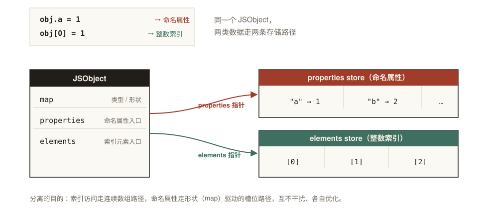
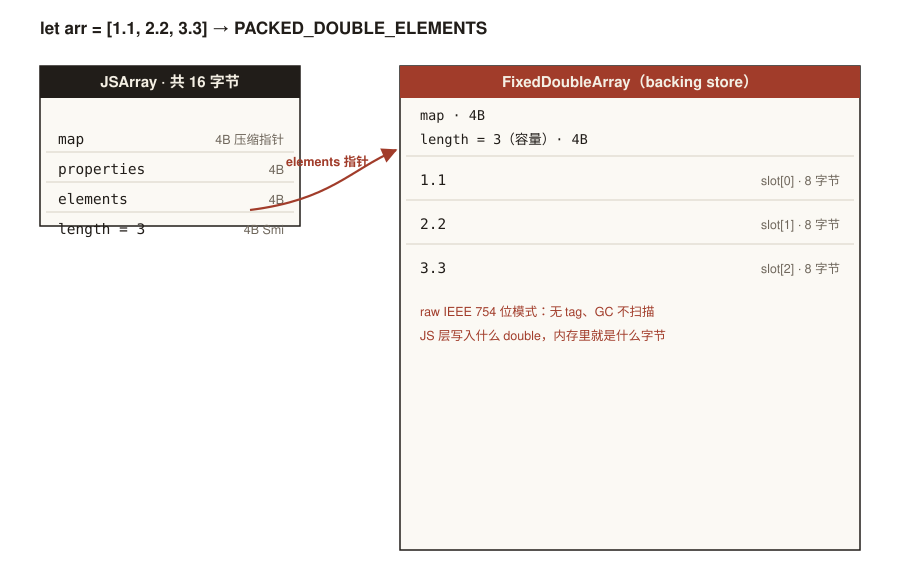
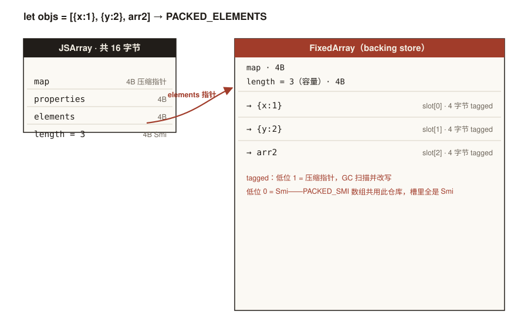
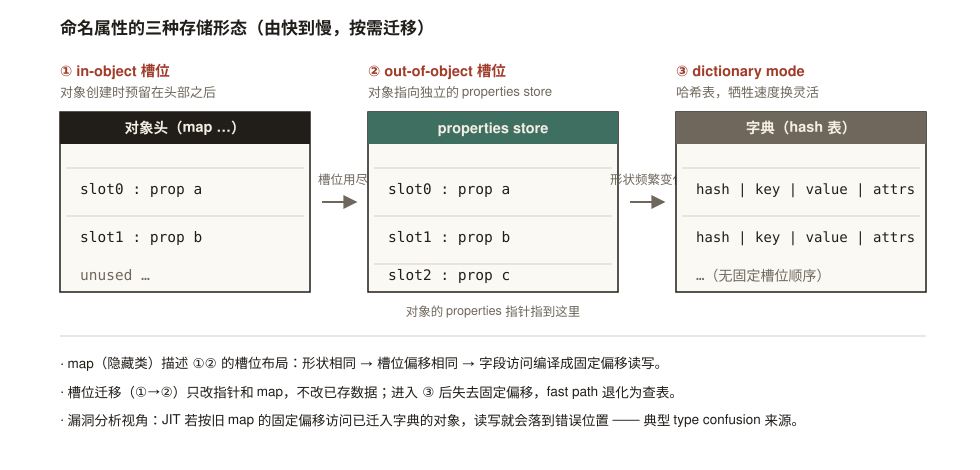

# V8 数组的内存布局

## 概述

V8 的漏洞利用，绝大多数最终都落在"数组的内存表示"上：越界读写发生在 elements 里，`addrof`/`fakeobj` 靠 double 数组和对象数组的互相误读，伪造对象头摆在 double 数组的 backing store 里。不理解数组的真实内存形态，就看不懂利用代码在做什么。

这篇文章用一个数组从创建到变形的全过程，把对象头、elements、properties 三件事讲清楚。所有结论都可以用 `%DebugPrint` 亲手验证。

## 对象结构

先建立总的图景。JavaScript 里 `obj.a = 1` 和 `obj[0] = 1` 看起来只是写法不同，在 V8 内部却走两条完全不同的存储路径：



每个 JSObject 头部都有三个关键字段：

| 字段 | 作用 |
|---|---|
| `map` | 描述这个对象的形状：类型、elements kind、属性槽位布局 |
| `properties` | 命名属性的入口（指向独立的属性仓库，见 Properties 存储） |
| `elements` | 整数索引元素的入口（指向本节的主角） |

用 `%DebugPrint` 看一个最普通的数组：

```js
// arr.js
let arr = [1.1, 2.2, 3.3];
%DebugPrint(arr);
```

```bash
./d8 --allow-natives-syntax arr.js
```

输出里能看到 elements kind、`elements` 指针和 length 字段。**先看 elements kind，再看 elements 指针，最后才看 length**——这个顺序是后面所有分析的习惯。

## Backing Store

### FixedDoubleArray

```js
let arr = [1.1, 2.2, 3.3];
```



三个关键事实：

1. **槽里是裸的 8 字节 IEEE 754 double**，不是 tagged value。你在 JS 层写 `1.1`，内存里就是 `1.1` 的位模式，精确可控。
2. **GC 不扫描这些槽**（没有指针语义），所以内容不会被 GC 意外改写。
3. "精确控制连续 8 字节"使 double 仓库成为**布置伪造对象头的标准工地**（利用视角见 FixedArray 一节）。

### FixedArray

```js
let objs = [{x:1}, {y:2}, anotherArr];
```



与 double 数组的本质区别：**槽里是 tagged value**——对象存压缩指针（4 字节，低位 1），小整数存 Smi（低位 0），GC 移动对象时会扫描并改写这些指针。纯 `PACKED_SMI_ELEMENTS` 数组共用同一种仓库，只是槽里全是 Smi。

**利用视角**：double 槽按 8 字节解释、对象槽按 4 字节压缩指针解释。一旦让引擎"用对象数组的眼睛看 double 数组的内存"（或反过来），一次错位读就同时得到 `addrof`（把指针当 double 读出地址）和 `fakeobj`（把 double 当指针造出对象）——伪造的对象头就摆在 double 仓库里，[CVE-2021-30517](CVE-2021-30517分析.md) 的 fake array 即此。SuperIC confusion 及众多历史漏洞，本质都是制造这种互读。

## Elements Kind 迁移

elements kind 记录在 map 里，是引擎对整个数组的**承诺**：仓库里每一格装什么、读取时可以省掉哪些检查。三档主链：

```text
PACKED_SMI_ELEMENTS → PACKED_DOUBLE_ELEMENTS → PACKED_ELEMENTS
（任何一档出现空洞 → 对应的 HOLEY_ 变体）
```

每次写入都相当于一次验收：新值比当前承诺更宽，整个数组就地升级。两步升级各自发生的事：

- **SMI → DOUBLE**：仓库从 FixedArray 换成 FixedDoubleArray——每格从 4 字节 tagged（Smi）变成 8 字节裸位模式。`[1,2,3]` 里的 1 是 tagged 编码，迁移后变成 `1.0` 的 IEEE 754 位模式。整仓搬家。
- **DOUBLE → OBJECT**：FixedDoubleArray 换回 FixedArray。double 不能裸躺在对象仓库里（那里的槽放指针），于是每个 double 被**装箱**成一个 HeapNumber 小对象，槽里改放它的指针。JS 层读回 `1.1` 还是 `1.1`，但内存里已经从"数"变成"指向数的指针"。
- **→ HOLEY**：`delete arr[0]` 或稀疏赋值留下空洞后，kind 加上 HOLEY 前缀，从此每个元素的读取都多一道 hole 检查（the_hole 不能泄漏到 JS 层）。

三步的仓库形态与编码变化（注意 JSArray 头 16 字节不变，变的是 map 与 elements 指针；4 字节槽与 8 字节槽的高度不同）：

![let a = [1,2,3]; a.push(1.1); a.push({}) — 三步迁移中的仓库与编码](images/v8-elements-kind-transition.svg)

亲手观察一次（接前面的 `arr.js`）：

```js
let a = [1, 2, 3];        // PACKED_SMI_ELEMENTS
%DebugPrint(a);
a.push(1.1);              // → PACKED_DOUBLE_ELEMENTS
%DebugPrint(a);
a.push({});               // → PACKED_ELEMENTS
%DebugPrint(a);
```

两次输出对比，**map 和 elements 指针同时变**——kind 记在 map 里，仓库整仓换新。

**为什么只升不降**：降级会当场打破承诺。SMI 数组的消费方（包括 JIT 按它生成的代码）默认槽里必是 Smi——不装箱、按数值直接运算、搬运槽位不做写屏障。假如允许把装过对象的数组降回 SMI，一个还躺着指针的槽就会被当 Smi 读出。所以常规写入只会加宽：`[1.1]` 再写整数 `1`，存进的是 `1.0`，数组不会变回 SMI。

唯一的合法"降级"是全量覆盖类操作（如 `fill`）：所有槽都被新值盖过，承诺重新成立，map 允许向后迁移；SMI 和 OBJECT 又共用 FixedArray，这种迁移只换 map、不搬仓库。混淆类漏洞攻击的正是这套规则的反面——让"map 声明的承诺"与"仓库的实际内容"分家。

迁移规则对漏洞分析的含义：

- **kind 决定读法**：同一个 8 字节，按 double 读是数、按对象读是两个并排的压缩指针——两种仓库的边界互读就是 `addrof`/`fakeobj`（见 Backing Store 一节）。
- **map 变更 = 优化代码失效点**：JIT 按"当前 map + elements kind"生成固定偏移的访问代码；迁移后旧代码必须 deopt 或被检查拦截。[CVE-2025-12433](CVE-2025-12433分析.md) 是"检查被错误消除"的样本，[CVE-2025-13224](CVE-2025-13224分析.md) 是"承诺与内容分家"的样本。
- **HOLEY 的代价**：hole 检查一旦被消掉，the_hole 直达 JS 层（12433 正是 hole 检查被错误消除的案例）。

## Length 与越界

JSArray 头部的 `length` 是 JS 层可见长度；backing store 自己还有 `length`（容量）。两者由引擎负责保持一致：

- 正常扩容：先分配更大 backing store、搬数据、再更新 JSArray 的 `length`——一套动作。
- 越界漏洞的统一形态：**让两者（或与优化器的认知）失配**。索引边界检查如果基于过期/错误的长度信息，写 `arr[n]` 就落到了仓库之外，破坏相邻对象——这就是 OOB 的全部原理。

分析任何数组相关漏洞时，先问三个问题：边界检查用的长度来自哪里？它何时更新？优化器对它的假设是否和运行时一致？

## Properties 存储

数组也是对象，`arr.name = value` 走的是 properties 路径。它有自己的三种形态，迁移方向同样"由快到慢"：



- **in-object 槽位**：对象创建时预留在头部之后，访问最快。
- **properties store**：槽位用尽后，对象通过 `properties` 指针指向独立仓库。
- **dictionary mode**：属性增删频繁、形状退化为哈希表，失去固定偏移。

map（隐藏类）记录着 ①② 的槽位布局：**形状相同的对象共享同一个 map，字段访问因此能编译成固定偏移读写**。这是 V8 快速路径的根基，也是 type confusion 的常见发源地——JIT 若按旧 map 的偏移访问已变形的对象，读写就落到错误位置（ChakraCore 的 [CVE-2019-0567](../chakracore/CVE-2019-0567.md) 就是同类机制在另一个引擎上的版本）。

## 分析检查项

- map 与 elements kind 是否符合预期（先看 map，再看 elements，最后看 length）
- elements 指向 FixedArray 还是 FixedDoubleArray，槽按 tagged 还是 raw double 解释
- 数组是否从 PACKED 迁移到了 HOLEY，迁移点在哪次写入
- `length` 与 backing store 容量是否一致，边界检查的长度来源是否新鲜
- 命名属性处于 in-object / store / dictionary 哪种形态，map 是否还匹配

## 参考资料

1. [V8 Team, Elements kinds in V8](https://v8.dev/blog/elements-kinds)
2. [V8 Team, Fast properties in V8](https://v8.dev/blog/fast-properties)
3. [V8 Team, Pointer Compression in V8](https://v8.dev/blog/pointer-compression)

> 站内相关：[V8 堆的内存布局](V8堆的内存布局.md)（对象住哪个空间、地址何时稳定） · [V8 指针压缩机制](V8指针压缩机制.md) · [CVE-2021-30517 分析](CVE-2021-30517分析.md)（elements 布局的实战利用） · [CVE-2025-12433 分析](CVE-2025-12433分析.md)（hole 与边界检查）
